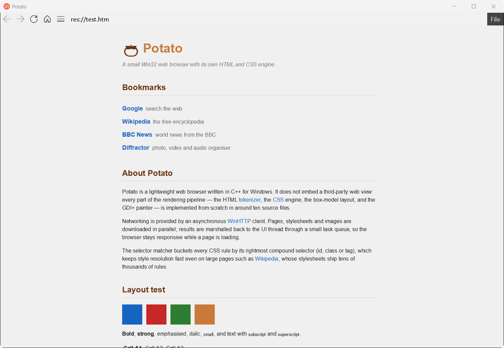

# Potato

[](https://github.com/ZacWalk/potato/actions/workflows/build.yml)

A web browser written from scratch in C++20 for Windows: HTML and some CSS, no
JavaScript. It was written to learn CSS by implementing it — probably the worst
web browser in the world — and is kept working well enough to display Wikipedia.



## What is in the box

A reusable engine and the browser that drives it, with no third-party HTML or
CSS library:

- **`src/libwebvis`** — the rendering engine, a standalone static library. An
  HTML tokenizer and parser that survives real-world markup (implicit tag
  closing, raw-text elements, entity decoding, charset sniffing); a CSS engine
  with selectors, specificity, combinators, the cascade, media queries, `calc()`
  and custom properties; and block, inline, float, flex and table layout.
- **`src/potato`** — the browser: window, toolbar, address bar, navigation
  history, painting through libdesktop's renderer and asynchronous loading
  through its HTTP services.

libwebvis has no platform dependency at all — it does not even link
[libdesktop](https://github.com/ZacWalk/libdesktop). The host hands it a
drawing surface and a service for text measurement and resources, so layout
needs no window: that is what makes the headless diagnostic modes possible, and
what lets libwebvis render a web view inside other applications.
[AGENTS.md](AGENTS.md#the-libwebvis-boundary) describes the boundary.

## Limitations

The engine does not support:

- CSS Grid: `display: grid` and `inline-grid` lay out as blocks with
  blockified children, and the grid template and placement properties are
  ignored;
- `min()`, `max()`, `clamp()` and `light-dark()`: a value using one falls back
  to the property's default;
- `margin-inline`, `row-gap`, `column-gap`, `object-fit` and
  `min-width: fit-content`;
- `vertical-align: sub` and `super`, so `<sub>` and `<sup>` sit on the baseline
  at their smaller size;
- quirks mode: `<center>` centres text but not a table, and a table inside it
  keeps the centred text;
- `data:` URLs, so an image or stylesheet given as one does not load;
- SVG: an SVG image is drawn as a plain frame of its size.

A page is drawn before its external stylesheets arrive and again after, so it
flashes unstyled while they load.

In the browser:

- only HTML and plain text display; any other content type, an image or a PDF,
  is parsed as HTML;
- form controls take up space but are not drawn and do nothing, and a form
  cannot be submitted;
- after a redirect the address bar keeps the address that was asked for, and
  relative links resolve against it;
- cookies a page sets are not sent with its stylesheets and images;
- there is no progress indicator and no Stop button (the keyboard's Browser
  Stop key cancels a load), and the old page stays on screen until the new one
  arrives;
- history is on the toolbar, the menu and the keyboard's Browser Back and
  Forward keys; `Alt+Left` and `Alt+Right` are not bound;
- the suggestions shown when the address bar takes focus are filtered by the
  address it holds, so they usually list only that address; history and
  bookmarks appear once the text is cleared or edited.

## Building

Requires Windows x64 and Visual Studio with the Desktop C++ workload. The
vendored [dd](https://github.com/ZacWalk/dd) runtime locates Visual Studio and
uses the CMake and Ninja that ship with it.

```powershell
.\dd.ps1 build                # both configurations
.\dd.ps1 test --label potato  # the offline suite, in both configurations
.\dd.ps1 test --label headless # the same offline gate, no visible UI, console case counts
.\dd.ps1 launch               # build Release, then start the browser
```

Output is `Exe\potato-64.exe`, or `potato-64d.exe` for Debug.

Both labels omit dd's visible window smoke check and the optional `network`
tests. The self-test prints every case and real pass/fail totals; its HTML
report is supplementary. Presets expose passing output too. After building,
use `ctest --preset debug -L headless -V --no-tests=error` (or `release`) to
rerun. Direct GUI-subsystem tests must be piped and awaited:
`& .\Exe\potato-64.exe --test-offline 2>&1 | Out-Host; $LASTEXITCODE`.

The engine can also be built without the browser or libdesktop, on another
platform, with a C++20 compiler:

```powershell
cmake -S . -B build\engine -DPOTATO_BUILD_APP=OFF -DCMAKE_BUILD_TYPE=Release
cmake --build build\engine
ctest --test-dir build\engine -L webvis --output-on-failure
```

Potato is a GUI application, but its diagnostic modes write to the console and
can be scripted: `.\dd.ps1 layout --file test-files/bbc-news.html --width 1902 --dump 4`
lays out a local page with no window and nothing downloaded, and
`.\dd.ps1 analyze-wiki-css` extracts Wikipedia's stylesheet variables for
comparison with the cascade. [AGENTS.md](AGENTS.md#testing) describes every mode.

### Icon

`python tools\generate_icon.py` regenerates `src\potato\res\potato.ico`
from the coral HTML-bracket vectors, in nine desktop sizes. Add `--check` to
verify without writing, or `--output tmp\icon-128.png --size 128` for another
size. Python 3.9+'s standard library and the vendored `tools\iconlib.py` are
sufficient; no sibling checkout or graphics package is required.

## Documentation

[AGENTS.md](AGENTS.md) — architecture, testing and conventions, for contributors and coding agents.

## License

[MIT](LICENSE). The browser includes
[libdesktop](https://github.com/ZacWalk/libdesktop), which is licensed under the
Mozilla Public License 2.0: anyone distributing the browser must tell its
recipients where to get libdesktop's source code, including any changes made to
it. libwebvis does not link it. `tools/iconlib.py` is vendored from libdesktop
under the same licence.

The licence does not cover the saved pages in `test-files/`: the Wikipedia pages
are by Wikipedia's contributors under CC BY-SA 4.0, and the BBC News page
belongs to the BBC.
